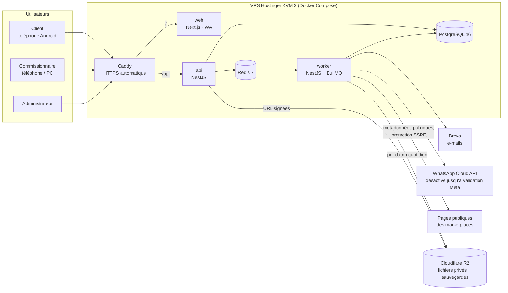

# 02 — Architecture technique Konzia

Contexte : un développeur, un VPS Hostinger **KVM 2** (2 vCPU, 8 Go RAM, 100 Go NVMe), pilote de 2 commissionnaires à Lubumbashi. Principe directeur : **peu de pièces mobiles**, un seul dépôt, un seul langage (TypeScript).

## 1. Vue d'ensemble



- Une seule origine (`https://app.<domaine>`) : `/` → Next.js, `/api` → NestJS. Pas de CORS, cookies simples.
- Les tâches lentes ou externes (e-mails, lecture d'URL, sauvegardes) passent par la file **BullMQ** et le **worker** : l'API reste rapide même si un service externe est lent.

## 2. Choix de la stack

| Couche | Choix | Pourquoi | Alternative écartée |
|---|---|---|---|
| Front client + pro + admin | **Next.js 15 (App Router) + TypeScript**, installable (PWA) | Un seul code pour les trois espaces ; pas de Play Store ; fonctionne sur Android d'entrée de gamme | React Native : 2e code à maintenir pour un développeur seul |
| UI | Tailwind CSS + composants maison sobres | Léger, pas de dépendance lourde | Bibliothèques de composants complètes (poids JS) |
| API | **NestJS 11** (monolithe modulaire), REST + OpenAPI généré | Recommandé par le cahier ; modules, gardes et intercepteurs adaptés au multi-tenant | Routes API de Next.js : frontières de modules floues |
| Validation | **Zod**, schémas partagés front/API (`packages/shared`) | Un seul schéma par formulaire, validé des deux côtés | class-validator (duplication) |
| Base de données | **PostgreSQL 16** | Transactions, Row-Level Security, JSONB | MySQL (pas de RLS) |
| ORM | **Prisma** | Migrations versionnées, typage ; un seul ORM | Drizzle (équivalent ; on n'en garde qu'un) |
| File d'attente | **Redis 7 + BullMQ** | Nouvelles tentatives, délais, tâches planifiées | n8n : pas source de vérité (cahier §9.2) |
| Fichiers | **Cloudflare R2** (compatible S3), seau privé, URL signées courtes | 10 Go gratuits, pas de frais de sortie, hors du VPS (survit à une panne) | Disque du VPS (sauvegarde plus fragile) |
| E-mail | **Brevo** via SMTP (adaptateur `nodemailer`) | Offre gratuite 300 e-mails/jour, bonne délivrabilité, SMTP standard → changement de fournisseur trivial | Boîte mail Hostinger : limites d'envoi et réputation moins adaptées au transactionnel |
| WhatsApp | Liens `wa.me` au MVP ; adaptateur **WhatsApp Cloud API** prêt, désactivé | Validation Meta requise | Fournisseurs non officiels (interdits par le cahier) |
| Reverse proxy | **Caddy** | Certificats HTTPS automatiques, configuration de 15 lignes | Nginx + Certbot |
| Gestion du dépôt | **pnpm workspaces** | Types partagés, une seule installation | Turborepo/Nx (inutile à cette taille) |
| Tests | Vitest (unitaires), Supertest + base PostgreSQL réelle (intégration), Playwright (parcours critiques) | Les tests d'isolation doivent tourner contre un vrai PostgreSQL avec RLS | Mocks de base de données |
| CI | GitHub Actions : lint, typecheck, tests, build des images | — | — |

## 3. Structure du dépôt

```
apps/
  web/                 Next.js : (public) (client) (pro) (admin)
  api/                 NestJS : un dossier par module ci-dessous
packages/
  shared/              schémas Zod, types, constantes (statuts, devises)
  db/                  schéma Prisma, migrations, politiques RLS (SQL), seed de développement
infra/
  docker-compose.yml   dev local
  deploy/              compose de production, Caddyfile, scripts de sauvegarde
docs/                  conception (ce dossier)
plans/                 plans de travail
```

## 4. Modules de l'API (monolithe modulaire)

| Module | Responsabilité | Tables principales |
|---|---|---|
| `auth` | Inscription, connexion, sessions, vérification e-mail, MFA admin | `users`, `sessions`, `email_tokens`, `consents` |
| `organizations` | Organisations, membres, rôles, invitations | `organizations`, `organization_members`, `invitations` |
| `customers` | Profils clients, clients gérés, adresses, import CSV/XLSX | `customer_profiles`, `managed_customers`, `addresses` |
| `verification` | Documents et statut des commissionnaires | `organization_verifications`, `documents` |
| `geo` | Villes, zones, étapes logistiques configurables | `cities`, `service_zones`, `route_templates` |
| `catalog` | Marketplaces, analyse d'URL, instantanés produit | `marketplaces`, `product_snapshots` |
| `quotes` | Demandes, devis, versions, ajustements | `quote_requests`, `quote_request_items`, `quote_request_recipients`, `quotes`, `quote_versions`, `quote_lines`, `quote_adjustments` |
| `orders` | Commandes, lignes, statuts, achats fournisseurs | `orders`, `order_items`, `order_events`, `supplier_orders`, `supplier_order_items` |
| `payments` | Paiements directs, preuves, remboursements, taux de change | `payments`, `payment_events`, `exchange_rates` |
| `logistics` | Colis, articles de colis, expéditions, événements | `parcels`, `parcel_items`, `parcel_events`, `shipments`, `shipment_parcels` |
| `notifications` | Centre de notifications, préférences, envoi e-mail/WhatsApp | `notifications`, `notification_preferences`, `outbound_messages` |
| `disputes` | Litiges et décisions | `disputes`, `dispute_entries` |
| `admin` | Console, supervision, suspension | (lit les autres modules) |
| `audit` | Journal d'audit transverse | `audit_logs` |
| `files` | URL signées R2, contrôle type/taille | `files` |

Règle : un module n'écrit **jamais** dans les tables d'un autre module ; il appelle son service. Cela permet de séparer un module plus tard sans réécriture.

Les intégrations externes sont derrière une interface interne (`EmailSender`, `WhatsAppSender`, `FileStorage`, `ProductMetadataFetcher`, `PaymentProvider` en V1). En développement, des implémentations factices sont utilisées, **nommées `Fake…`** et refusées au démarrage si `NODE_ENV=production`.

## 5. Isolation multi-tenant (risque n°1)

Deux barrières indépendantes :

1. **Gardes NestJS** : chaque requête porte un contexte `{ userId, organizationId?, role, isPlatformAdmin }`. Les services filtrent toujours par ce contexte.
2. **Row-Level Security PostgreSQL** : chaque requête ouvre une transaction et fixe
   `SET LOCAL app.user_id = …; SET LOCAL app.org_id = …;`.
   L'application se connecte avec un rôle **sans** `BYPASSRLS`. Les politiques autorisent une ligne si :
   - `organization_id = current_setting('app.org_id')` (membre du commissionnaire), **ou**
   - la ligne appartient au client connecté (`customer_user_id = current_setting('app.user_id')`), selon la table.

   La console admin utilise un rôle distinct, chaque lecture sensible étant journalisée.

Pour les colis partagés entre plusieurs clients : le client n'accède jamais à `parcels` directement, mais à la vue `customer_parcel_tracking` qui ne renvoie que ses propres `parcel_items` et les événements du colis, sans les autres articles.

Tests obligatoires (étape 1.3, puis à chaque nouvelle table) : pour chaque table métier, un test crée des données chez A et vérifie que B obtient 0 ligne en lecture et une erreur en écriture, **même en contournant la garde** (requête SQL directe avec le contexte de B).

## 6. Authentification et sessions

- Mots de passe hachés en **Argon2id**.
- Sessions opaques stockées en base (jeton aléatoire, seul son hachage est stocké), cookie `HttpOnly; Secure; SameSite=Lax`. Révocation immédiate (« déconnecter tous les appareils »), contrairement aux JWT.
- Protection CSRF : `SameSite=Lax` + en-tête personnalisé obligatoire sur les requêtes d'écriture.
- Limitation de débit (Redis) sur connexion, inscription, réinitialisation, import d'URL.
- MFA TOTP obligatoire pour les administrateurs de la plateforme.

## 7. Import d'URL et protection SSRF

1. Analyse : HTTPS uniquement, domaine dans la liste blanche `marketplaces.domains`, normalisation (suppression des paramètres de pistage).
2. Le worker résout le DNS, **refuse toute IP privée, locale, de lien local ou de métadonnées cloud**, puis se connecte à l'IP vérifiée (pas de seconde résolution, contre le « DNS rebinding »).
3. Redirections suivies manuellement (max. 3), chaque cible revérifiée.
4. Délai 5 s, taille max. 2 Mo, seul `text/html` accepté ; lecture des balises Open Graph / JSON-LD publiques uniquement.
5. Résultat stocké dans `product_snapshots` avec source, date et mention « indicatif ». Aucun contournement de CAPTCHA ou de protection anti-robot : en cas d'échec, saisie manuelle.

## 8. Argent et devises

- Montants en **entiers** (centimes USD, centimes CDF, fen CNY) + code ISO 4217.
- `exchange_rates(base, quote, rate_decimal, source, valid_from, created_by)`. Chaque `quote_version` copie le taux utilisé : un changement de taux ne modifie jamais un devis existant.
- Coût réel (`supplier_orders`) et prix facturé (`quote_lines` / `order_items`) dans des tables distinctes.

## 9. Déploiement sur Hostinger KVM 2

| Élément | Choix |
|---|---|
| Système | Ubuntu 24.04 LTS, mises à jour de sécurité automatiques, pare-feu (ports 22, 80, 443), connexion SSH par clé uniquement |
| Conteneurs | Docker Compose : `caddy` (partagé), puis par environnement `web`, `api`, `postgres`, `redis`, `backup` et la tâche `migrate`. Au MVP, la file d'envoi (BullMQ) et les tâches planifiées tournent dans le processus de l'API ; un conteneur `worker` séparé viendra si le volume l'exige. Fichiers : `infra/deploy/` |
| Environnements | `production` et `staging` sur le même VPS (deux projets Compose, deux bases, sous-domaines `app.` et `staging.`). Le développement se fait en local. |
| Livraison | GitHub Actions construit les images → GitHub Container Registry → `docker compose pull && up -d` par SSH ; migrations Prisma exécutées avant le redémarrage de l'API |
| Sauvegardes | `pg_dump` chiffré par `age` (clé publique sur le serveur, clé privée hors ligne) chaque nuit vers R2 (rétention 30 jours) + instantané hebdomadaire Hostinger ; `infra/deploy/restore-test.sh` avant le pilote puis chaque mois |
| Surveillance | Logs JSON (Pino) sans données personnelles ; Sentry (offre gratuite) pour les erreurs ; sonde de disponibilité externe (UptimeRobot gratuit) |
| Ressources estimées | ~2,5 Go RAM pour la production, ~1,5 Go pour staging : marge confortable sur 8 Go |

## 10. Ce qui est volontairement absent du MVP

Microservices, Kubernetes, application native, moteur de recherche, paiement intégré, cache de résultats de recherche, n8n. L'architecture modulaire et les adaptateurs permettent de les ajouter sans réécrire le cœur.
