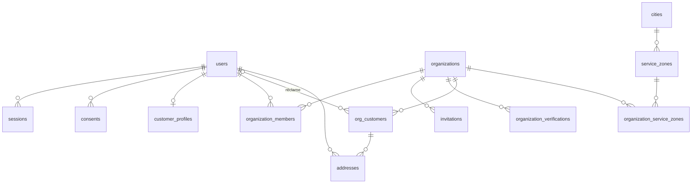
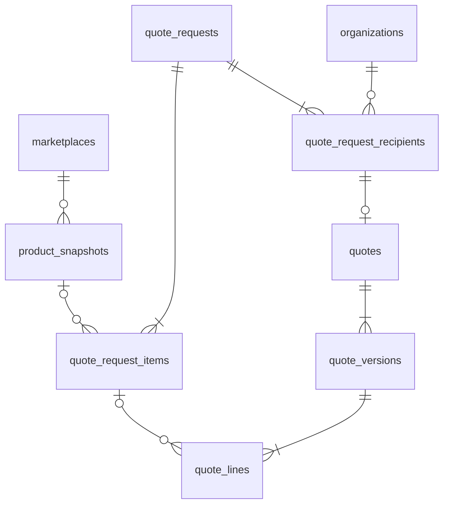
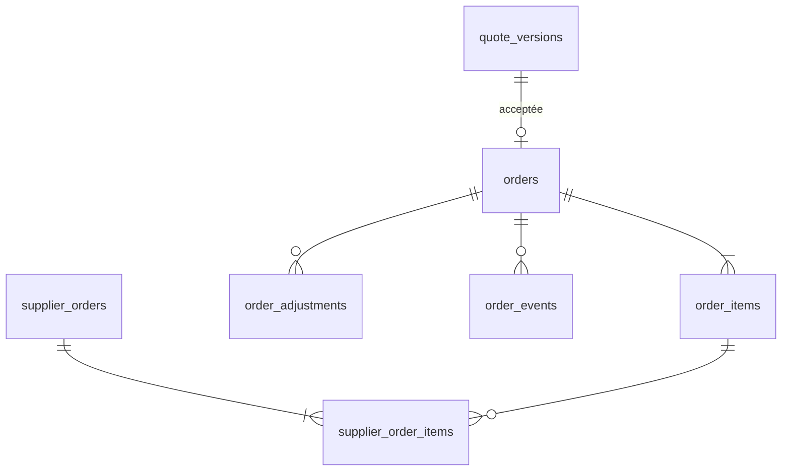
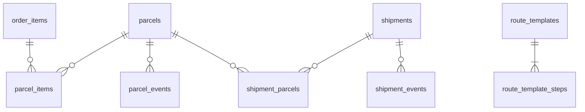

# 03 — Modèle de données Konzia (MVP)

Conventions :
- Clés primaires `id uuid` (v7, triables par date). Toutes les tables ont `created_at`, `updated_at`.
- Montants : `*_amount bigint` en unité mineure + `currency char(3)` (`USD`, `CDF`, `CNY`).
- Taux : `numeric(18,8)`.
- **Aucune suppression physique** des devis, commandes, paiements, colis et événements : statuts `cancelled` / `archived`.
- Tables d'événements (`*_events`, `audit_logs`) : **insertion seule** (droits `UPDATE`/`DELETE` retirés au rôle applicatif).
- Colonne `organization_id` sur toute donnée professionnelle → politique RLS (voir §8).

## 1. Idée centrale : le « client du commissionnaire »

Chaque relation entre un commissionnaire et un client passe par **`org_customers`** :
- client **avec compte** : `user_id` renseigné (fiche créée automatiquement quand il envoie sa première demande à ce commissionnaire) ;
- **client géré** : `user_id` vide (créé à la main ou par import Excel) ;
- **réclamation** : le client reçoit un lien, crée son compte, `user_id` est renseigné et `claimed_at` daté. L'historique suit automatiquement.

C'est aussi la liste « Clients » du commissionnaire (son petit CRM). Deux commissionnaires ont chacun leur propre fiche pour le même humain : jamais de partage entre organisations.

## 2. Identité et organisations

| Table | Colonnes clés |
|---|---|
| `users` | `email` (unique, citext), `email_verified_at`, `password_hash`, `display_name`, `phone_whatsapp`, `locale` (`fr`), `is_platform_admin`, `platform_role` (`admin`/`support`/null), `mfa_secret_enc`, `status` (`active`/`suspended`) |
| `sessions` | `user_id`, `token_hash`, `user_agent`, `ip_hash`, `last_seen_at`, `expires_at`, `revoked_at` |
| `email_tokens` | `user_id`, `purpose` (`verify`/`reset`/`invite`/`claim`), `token_hash`, `expires_at`, `used_at` |
| `consents` | `user_id`, `kind` (`terms`/`privacy`/`marketing`), `version`, `granted`, `at` |
| `customer_profiles` | `user_id`, `city_id`, `commune`, `delivery_instructions` |
| `organizations` | `type` (`independent`/`company`), `name`, `slug`, `description`, `city_id`, `phone_whatsapp`, `is_platform_operated`, `status` (`pending`/`approved`/`rejected`/`suspended`), `supported_marketplace_ids uuid[]`, `transport_modes text[]`, `pricing_policy text`, `payment_instructions jsonb` |
| `organization_members` | `organization_id`, `user_id`, `role` (`owner`/`sales`/`buyer`/`logistics`/`accountant`/`courier`), `status` — unique (`organization_id`, `user_id`) |
| `invitations` | `organization_id`, `email`, `role`, `token_hash`, `expires_at`, `accepted_at` |
| `organization_verifications` | `organization_id`, `status`, `submitted_at`, `decided_by`, `decided_at`, `reason` |
| `documents` | `organization_id`, `verification_id`, `kind`, `file_id`, chiffré (clé applicative) |
| `org_customers` | `organization_id`, `user_id` (nullable), `full_name`, `phone_whatsapp`, `email`, `city_id`, `service_zone_id`, `address_line`, `landmark`, `notes_private`, `claim_token_hash`, `claim_token_expires_at`, `claimed_at`, `source` (`signup`/`manual`/`import`), `status` (`active`/`merged`/`archived`), `merged_into_id` — unique (`organization_id`, `user_id`) parmi les fiches actives |
| `addresses` | `user_id` (adresses personnelles, RLS par utilisateur), `label`, `city_id`, `service_zone_id`, `line`, `landmark`, `is_default`. L'adresse d'un client géré est portée par sa fiche `org_customers` (D7). |
| `cities` | `name`, `country` (`CD`), `is_active`, `timezone` |
| `service_zones` | `city_id`, `name` (commune/quartier) |
| `organization_service_zones` | `organization_id`, `service_zone_id`, `handover_modes text[]` (`pickup`/`delivery`/`partner_point`), `local_fee_amount`, `currency` |
| `customer_imports` | `organization_id`, `file_id`, `status`, `rows_total`, `rows_ok`, `errors jsonb` |

## 3. Produits, demandes et devis

| Table | Colonnes clés |
|---|---|
| `marketplaces` | `name`, `domains text[]`, `access_mode` (`url_import`/`official_api`/`affiliate`), `is_enabled`, `terms_checked_at` |
| `product_snapshots` | `marketplace_id` (nullable si domaine inconnu), `source_url`, `canonical_url`, `title`, `image_url`, `price_amount`, `currency`, `source` (`open_graph`/`json_ld`/`manual`), `fetched_at`, `fetch_status`, `created_by` |
| `quote_requests` | `customer_user_id` (nullable), `created_by_organization_id` (nullable : demande saisie par un commissionnaire pour un client géré), `city_id`, `delivery_address_snapshot jsonb`, `status`, `deadline_at`, `sent_at` |
| `quote_request_items` | `quote_request_id`, `product_snapshot_id`, `source_url`, `title`, `variant`, `size`, `color`, `quantity`, `notes`, `screenshot_file_id`, `position` |
| `quote_request_recipients` | `quote_request_id`, `organization_id`, `org_customer_id`, `status` (`sent`/`viewed`/`evaluating`/`quoted`/`declined`/`expired`), `viewed_at` — unique (`quote_request_id`, `organization_id`) |
| `quotes` | `recipient_id` (unique), `organization_id`, `org_customer_id`, `customer_user_id` (copie pour RLS), `current_version_no`, `status` (`draft`/`sent`/`accepted`/`rejected`/`changes_requested`/`expired`/`withdrawn`) |
| `quote_versions` | `quote_id`, `organization_id`, `version_no`, `status`, `currency`, `subtotal_amount`, `total_amount`, `fx_usd_cdf`, `fx_usd_cny`, `fx_source`, `fx_at`, `valid_until`, `lead_time_min_days`, `lead_time_max_days`, `assumptions`, `cancellation_terms`, `sent_at`, `created_by` — **figée une fois envoyée** |
| `quote_lines` | `quote_version_id`, `organization_id`, `kind` (`product`/`seller_shipping`/`service_fee`/`international_shipping`/`handling`/`customs_estimate`/`local_delivery`/`insurance`/`discount`), `quote_request_item_id`, `description`, `quantity`, `unit_amount`, `amount`, `is_estimate bool` |

Règles portées par la base :
- `quote_versions` unique (`quote_id`, `version_no`).
- Total recalculé côté serveur à l'envoi ; un déclencheur refuse toute modification d'une version au statut `sent` ou au-delà.
- Acceptation impossible si `valid_until < now()` (contrôle en transaction).

## 4. Commandes et achats

| Table | Colonnes clés |
|---|---|
| `orders` | `number` (`KZ-2026-000123`, séquence), `organization_id`, `org_customer_id`, `customer_user_id`, `quote_version_id` (unique), `currency`, `agreed_total_amount`, `final_amount`, `status` (opérationnel), `payment_status` (`unpaid`/`partially_paid`/`paid`/`refunded`/`partially_refunded`), `cancelled_reason` |
| `order_items` | `order_id`, `organization_id`, `customer_user_id`, `quote_line_id`, `description`, `variant`, `qty_ordered`, `qty_purchased`, `qty_received`, `unit_price_amount` |
| `order_adjustments` | `order_id`, `organization_id`, `amount_delta`, `reason`, `status` (`proposed`/`accepted`/`rejected`), `proposed_by`, `decided_by`, `decided_at` |
| `order_events` | `order_id`, `organization_id`, `type`, `from_status`, `to_status`, `actor_user_id`, `note`, `at` (insertion seule) |
| `supplier_orders` | `organization_id`, `marketplace_id`, `store_name`, `external_ref`, `purchased_at`, `amount`, `currency`, `fx_rate_to_usd`, `conversion_fee_amount`, `seller_tracking_number`, `proof_file_id`, `status` (`placed`/`shipped_by_seller`/`received`/`partially_received`/`refunded`/`cancelled`) |
| `supplier_order_items` | `supplier_order_id`, `order_item_id`, `organization_id`, `qty_purchased`, `qty_received`, `qty_missing` |

Un achat fournisseur peut couvrir des lignes de plusieurs commandes (un commissionnaire regroupe ses achats sur une même boutique) : d'où la table de liaison.

## 5. Paiements et taux

| Table | Colonnes clés |
|---|---|
| `payments` | `organization_id`, `order_id`, `org_customer_id`, `customer_user_id`, `kind` (`payment`/`refund`), `method` (`mobile_money`/`cash`/`bank_transfer`/`other`), `amount`, `currency`, `payer_reference`, `proof_file_id`, `status` (`declared`/`pending_verification`/`confirmed`/`rejected`/`cancelled`), `declared_by`, `confirmed_by`, `confirmed_at`, `rejection_reason`, `idempotency_key` (unique) |
| `payment_events` | `payment_id`, `organization_id`, `type`, `actor_user_id`, `data jsonb`, `at` (insertion seule) |
| `exchange_rates` | `base`, `quote`, `rate`, `source`, `valid_from`, `created_by` (global, géré par l'admin) |

Statuts de paiement intégré (`initiated`, `provider_confirmed`, `failed`, `expired`, `disputed`) ajoutés en V1 avec la table `payment_provider_webhooks` (idempotence).

## 6. Logistique

| Table | Colonnes clés |
|---|---|
| `parcels` | `organization_id`, `code` (`KZ-P-7KD3QX`, unique), `location_label`, `weight_g`, `length_mm`, `width_mm`, `height_mm`, `volumetric_divisor` (ex. 5000/6000), `volumetric_weight_g` (calculé), `condition` (`ok`/`damaged`/`opened`), `current_step_code`, `route_template_id`, `status` (`open`/`closed`/`delivered`/`lost`/`cancelled`) |
| `parcel_items` | `parcel_id`, `order_item_id`, `organization_id`, `customer_user_id`, `org_customer_id`, `quantity`, `added_at`, `added_by`, `removed_at`, `removed_by`, `removed_reason` (retrait = marquage, jamais suppression) |
| `parcel_events` | `parcel_id`, `organization_id`, `step_code`, `occurred_at`, `location`, `note`, `photo_file_ids uuid[]`, `recorded_by` (insertion seule) |
| `shipments` | `organization_id`, `mode` (`air`/`sea`/`road`/`other`), `origin`, `destination`, `carrier`, `reference`, `tracking_number`, `departure_est`, `departure_at`, `arrival_est`, `arrival_at`, `cost_amount`, `currency`, `status` |
| `shipment_parcels` | `shipment_id`, `parcel_id`, `organization_id` |
| `shipment_events` | comme `parcel_events` ; un événement d'expédition est répercuté sur ses colis |
| `route_templates` | `organization_id` (nul = modèle global), `name`, `mode` |
| `route_template_steps` | `route_template_id`, `position`, `code`, `label_fr`, `visible_to_customer bool` |

Modèle global par défaut : les 19 étapes du cahier §5.4 ; chaque commissionnaire peut en dériver un modèle plus court.

## 7. Notifications, litiges, fichiers, audit

| Table | Colonnes clés |
|---|---|
| `notifications` | `recipient_user_id`, `organization_id` (nullable), `type`, `title`, `body`, `link`, `read_at` |
| `notification_preferences` | `user_id`, `type`, `channel` (`in_app`/`email`/`whatsapp`), `enabled` |
| `outbound_messages` | `channel`, `to`, `template`, `payload jsonb`, `status`, `attempts`, `last_error`, `sent_at` (sans contenu sensible en clair dans les logs) |
| `disputes` | `order_id`, `organization_id`, `customer_user_id`, `reason`, `status` (`open`/`awaiting_commissioner`/`under_review`/`resolved`/`closed`), `resolution`, `decided_by`, `decided_at` |
| `dispute_entries` | `dispute_id`, `organization_id`, `author_user_id`, `author_side` (`customer`/`commissioner`/`support`), `body`, `file_ids uuid[]`, `is_internal_note`, `at` (insertion seule) |
| `files` | `owner_user_id`, `organization_id`, `purpose`, `storage_key`, `mime`, `size_bytes`, `sha256`, `encrypted bool` |
| `audit_logs` | `actor_user_id`, `actor_role`, `organization_id`, `action`, `entity_type`, `entity_id`, `before jsonb`, `after jsonb`, `reason`, `ip_hash`, `at` (insertion seule) |
| `idempotency_keys` | `key`, `user_id`, `route`, `response_hash`, `created_at` (requêtes d'écriture rejouées après coupure réseau) |

## 8. Politiques Row-Level Security (résumé)

| Table(s) | Lecture autorisée si… | Écriture autorisée si… |
|---|---|---|
| `organizations` (champs publics via vue `public_commissioners`) | `status = approved` ou membre | membre `owner` |
| `org_customers`, `customer_imports` | membre de l'organisation | membre (`owner`, `sales`) |
| `quote_requests`, `quote_request_items` | client propriétaire, ou organisation destinataire (via `quote_request_recipients`) | client propriétaire (brouillon) ; organisation créatrice pour un client géré |
| `quote_request_recipients` | client propriétaire, ou organisation concernée | organisation concernée (statut) |
| `quotes`, `quote_versions`, `quote_lines` | organisation ; client (`customer_user_id`) **seulement si la version est envoyée** | organisation |
| `orders`, `order_items`, `order_adjustments`, `order_events` | organisation ; client propriétaire | organisation ; client pour accepter/refuser un ajustement (via fonction contrôlée) |
| `supplier_orders`, `supplier_order_items` | **organisation uniquement** (coûts réels privés) | organisation (`owner`, `buyer`) |
| `payments`, `payment_events` | organisation ; client propriétaire | client : déclarer ; organisation : confirmer/refuser |
| `parcels`, `shipments`, `*_events` | **organisation uniquement** | organisation (`owner`, `logistics`) |
| Vues `customer_parcel_tracking`, `customer_parcel_events` | client (via `org_customers.user_id`) : ses `parcel_items` + étapes visibles du colis, sans notes (D8) | — |
| `disputes`, `dispute_entries` | organisation ; client propriétaire ; support (notes internes masquées au client) | selon le côté |
| `audit_logs` | admin plateforme ; membres `owner` pour leur organisation | insertion par l'application uniquement |

Les rôles internes (`sales`, `buyer`…) sont vérifiés par les gardes NestJS ; la RLS garantit la frontière **entre organisations** et **entre clients**.

## 9. Couverture des règles métier du cahier (§7)

| Règle §7 | Mécanisme |
|---|---|
| 1. Plusieurs commissionnaires par demande | `quote_request_recipients` |
| 2. Un devis = un commissionnaire | `quotes.organization_id`, unique par destinataire |
| 3–4. Devis accepté → commande distincte, un responsable | `orders.quote_version_id` unique ; `orders.organization_id` |
| 5–6. Plusieurs lignes ; achat partiel | `order_items` ; `qty_purchased`/`qty_received` ; `supplier_order_items` |
| 7–8. Commande sur plusieurs colis ; colis multi-commandes | `parcel_items` (plusieurs-à-plusieurs) |
| 9. Accès colis filtré | RLS + vue `customer_parcel_tracking` |
| 10. Coût réel ≠ prix facturé | `supplier_orders` vs `quote_lines`/`order_items` |
| 11. Paiement ≠ livraison | `orders.payment_status` séparé de `orders.status` |
| 12. Modification de prix acceptée | `order_adjustments` |
| 13. Devis expiré non acceptable | contrôle `valid_until` en transaction |
| 14. Évaluation après commande terminée | V1 (`reviews` contrainte sur `orders.status = completed`) |
| 15. Actions sensibles auditées | `audit_logs` |
| 16. Pas de suppression physique | statuts + droits SQL retirés |
| 17. Taux avec source/date/valeur | `exchange_rates` + copie dans `quote_versions` |
| 18. USD et CDF dès le MVP, CNY pour l'achat | `currency` partout |
| 19. Prix tiers non final | `product_snapshots` marqué indicatif |
| 20. Douane non inventée | `quote_lines.kind = customs_estimate` saisi par le commissionnaire, `is_estimate = true` |
