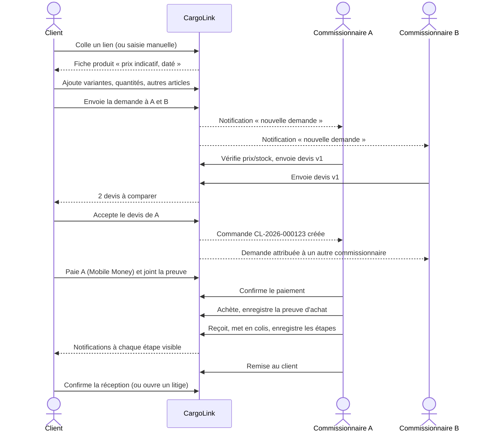
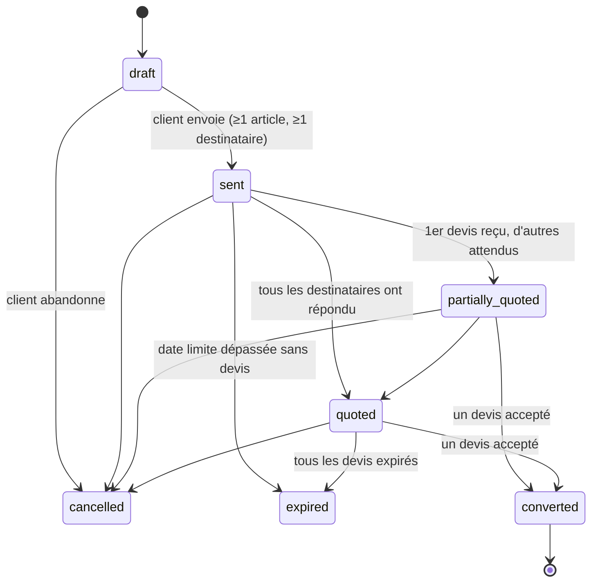
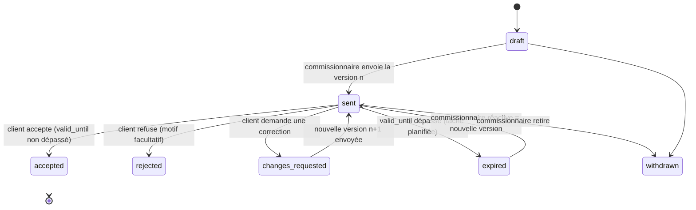
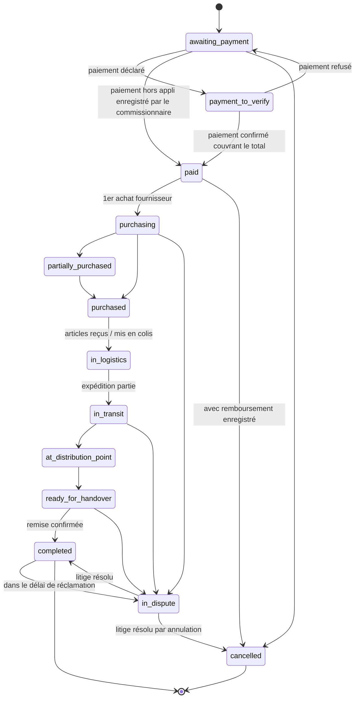
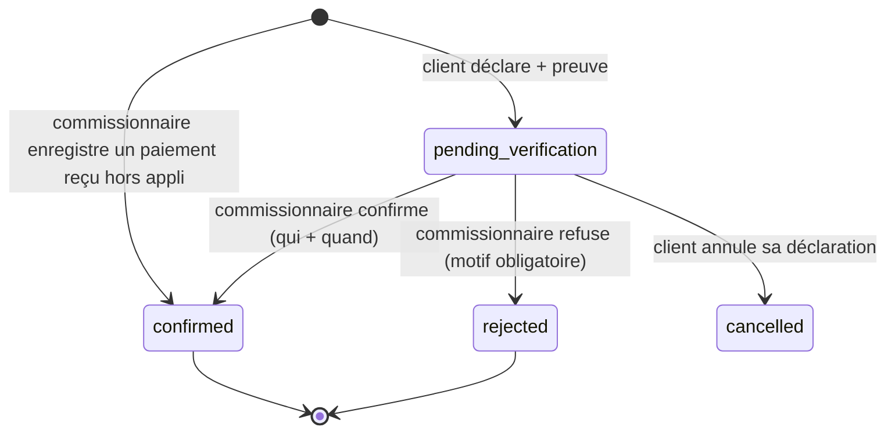
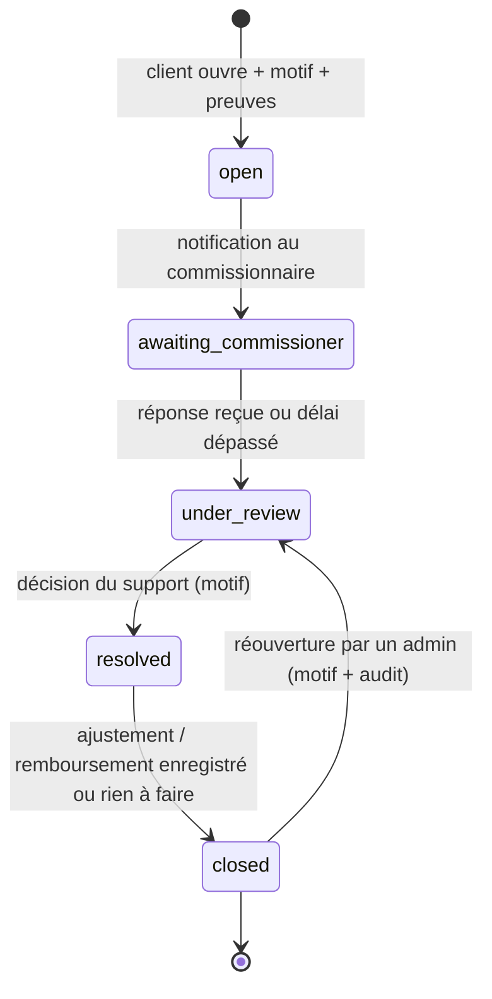
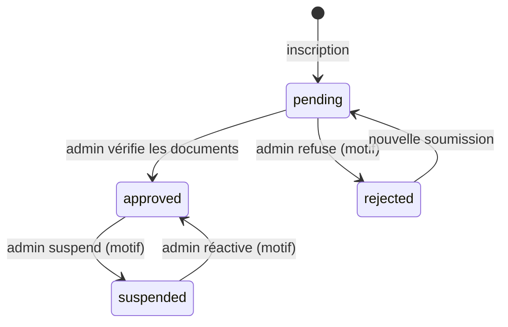

# 05 — États et parcours CargoLink

Chaque transition est faite par une **fonction de service unique** (`quotes.send()`, `payments.confirm()`…) qui vérifie l'état de départ, écrit l'événement et l'audit dans la même transaction. Aucune route ne modifie un statut directement.

## 1. Parcours principal (client avec compte)

Variante **client géré** : le commissionnaire crée la demande, le devis et l'acceptation pour le client (acceptation tracée « reçue par WhatsApp le … »), puis envoie le devis/suivi via un lien `wa.me`.

## 2. Demande de devis (`quote_requests.status`)

Statut par destinataire (`quote_request_recipients.status`) : `sent → viewed → evaluating → quoted | declined | expired`.

Note : une demande peut être convertie plusieurs fois si le client répartit ses articles entre commissionnaires (chaque devis accepté ne couvre que ses lignes). La demande passe à `converted` dès la première acceptation ; les autres devis restent acceptables jusqu'à leur expiration.

## 3. Devis (`quotes.status` + versions)

- Une version envoyée est **figée**. Toute modification = nouvelle version.
- `accepted` crée la commande dans la même transaction et lie `orders.quote_version_id`.

## 4. Commande — statut opérationnel (`orders.status`)

- **Règle clé** : impossible de passer à `purchasing` tant que `payment_status ≠ paid` (sauf si le commissionnaire coche « achat avancé sur fonds propres », tracé dans l'audit).
- Le statut de la commande est **dérivé** des colis lorsqu'ils avancent (le colis le moins avancé détermine l'étape affichée), mais peut être forcé par le commissionnaire avec une note.

## 5. Statut de paiement de la commande (`orders.payment_status`)

Calculé à partir des paiements `confirmed` : `unpaid → partially_paid → paid`, puis `partially_refunded` / `refunded` si des remboursements sont confirmés.

## 6. Paiement (`payments.status`)

Un remboursement est un **nouveau** paiement `kind = refund`, jamais une modification du paiement d'origine.

## 7. Colis (`parcels.current_step_code` + `status`)

Étapes du modèle global (configurables, issues du cahier §5.4) :

```mermaid
stateDiagram-v2
  direction LR
  [*] --> received_origin_warehouse
  received_origin_warehouse --> checked
  checked --> weighed
  weighed --> consolidated
  consolidated --> ready_international
  ready_international --> shipped_to_drc
  shipped_to_drc --> in_transit
  in_transit --> arrived_drc
  arrived_drc --> customs
  customs --> released
  released --> at_distribution_point
  at_distribution_point --> ready_for_handover
  ready_for_handover --> out_for_delivery
  ready_for_handover --> delivered: retrait
  out_for_delivery --> delivered
  delivered --> [*]
```

- Un événement `anomaly` (bloqué, perdu, endommagé) peut être enregistré à n'importe quelle étape, avec photo et note ; il notifie le client et peut ouvrir un litige.
- Les étapes avant colis (en attente d'achat, acheté, expédié par le vendeur) sont portées par les **achats fournisseurs**, pas par le colis.
- `status` : `open` (on peut ajouter/retirer des articles) → `closed` (scellé, prêt à expédier) → `delivered` | `lost` | `cancelled`.
- Chaque étape enregistrée = une ligne `parcel_events` (horodatée, auteur, lieu), jamais modifiée. Une erreur se corrige par un nouvel événement `correction`.

## 8. Litige (`disputes.status`)

## 9. Organisation (`organizations.status`)

